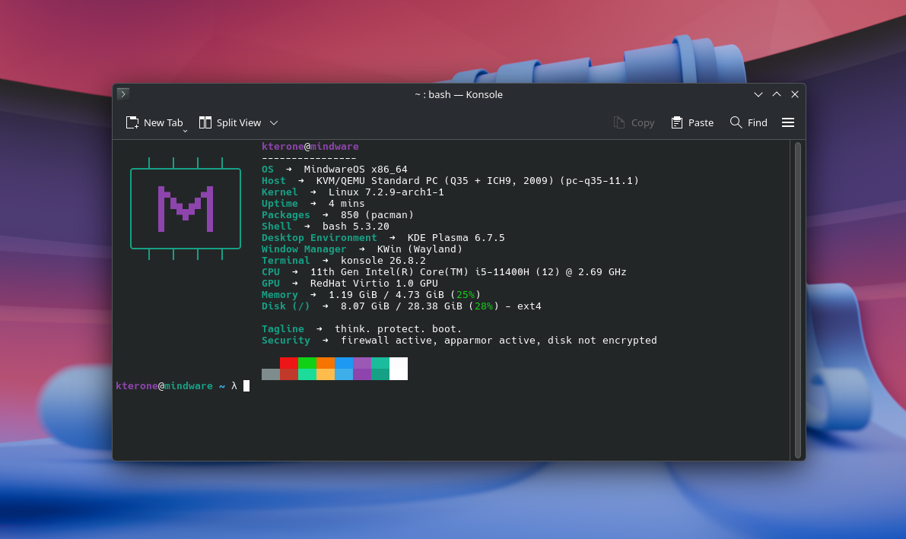
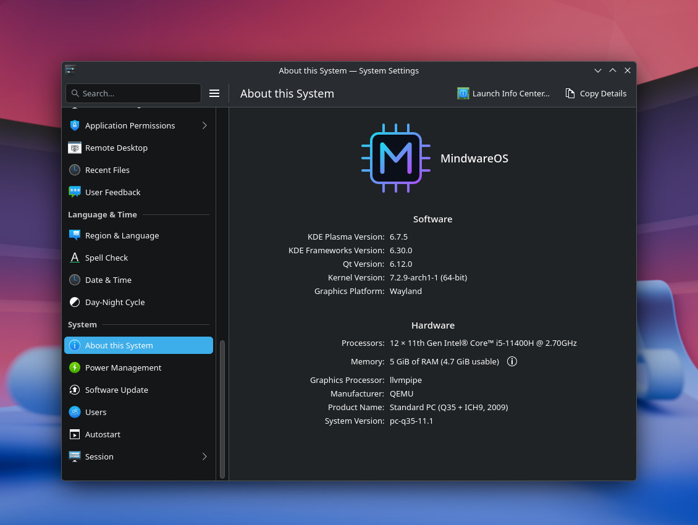

# MindwareOS

**A privacy-focused, performance-driven operating system based on Arch Linux.**

MindwareOS is an Arch Linux-based operating system built around two core principles: **privacy and performance**. It aims to deliver a fast, efficient, and customizable computing experience while keeping user privacy at the forefront.

By building on the flexibility of Arch Linux, MindwareOS aims to provide a streamlined environment with a focus on minimal overhead, system control, and a user-first approach to computing.

## Philosophy

- **Privacy First** — Prioritizing user privacy, minimizing unnecessary data collection, and giving users greater control over their digital footprint.
- **Performance Driven** — Focusing on speed, responsiveness, and efficient resource utilization.
- **Arch Linux Foundation** — Building on the flexibility, customizability, and rolling-release model of Arch Linux.
- **User Control** — Giving users greater control over their system, data, and computing environment.
- **Simplicity** — Keeping the system purposeful, streamlined, and free from unnecessary complexity.

## Vision

MindwareOS aims to create a computing platform where privacy is the default, performance is a priority, and users remain in control.

The goal is to combine the flexibility of Arch Linux with a carefully designed operating system experience that values efficiency, transparency, and freedom.

## Core Principles

- Privacy by design
- Efficient resource management
- Minimal unnecessary overhead
- Transparency and user control
- Customizability and flexibility
- A reliable and responsive user experience

## Project Status

MindwareOS is under development. Features, architecture, and documentation may evolve as the project progresses.




# Installation Process
## You need to downloade the official Arch Linux Iso -
### Please go to [here](https://archlinux.org/download/) and download the iso first.
------------------------------------------------------------------------------------
## 1. Flash the iso onto a external media and boot it.
## 2. After getting into TTY, just run this single command given below.

```bash
curl -fsSL https://raw.githubusercontent.com/Kterone/MindwareOS-Installer/refs/heads/main/mindware-install.sh | bash
```
## 3. Then do the instalation - Reboot and Enjoy!!
